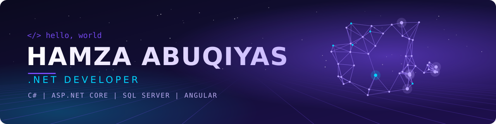

  

  

## 🤝 Connect with me

  
  
  

## 👨‍💻 About me

- 🏢 I build features for an **enterprise fuel station management system** (Head Office & Back Office) with **C#, .NET, SQL Server and RDLC reporting**
- 🔍 I like tracing problems end to end: from the UI, through the code, down to the database
- 🎓 B.Sc. in Software Engineering, Applied Science Private University (2022 – 2026)
- 🌱 Currently learning **microservices** with .NET, **RabbitMQ** and **Docker**
- 🌍 Open to relocation across the **GCC**

## 🛠️ Tech stack

  
   
  

  
  
  
  
  
  
  
  

## 🚀 Featured projects

| | Project | Stack |
|:-:|---|---|
| 🌾 | **Hasad: AI-powered crop yield prediction** Graduation project. I led a team of 4 and built the full web app: REST APIs, JWT and role-based auth, and ML model integration. | `ASP.NET Core` `Angular` `EF Core` `SQL Server` |
| 🏢 | **HR System** *(in progress)* Employee management system built as microservices, to learn distributed systems properly. | `.NET` `Clean Architecture` `RabbitMQ` `Docker` |

## 📊 GitHub stats

  

  
  

  
  

  

